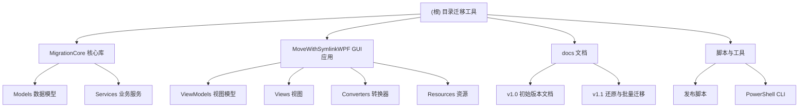

# 目录迁移工具 - AI 上下文文档

> 最后更新：2025-12-15 01:06:52
> 版本：v1.1.5

## 变更记录 (Changelog)

### 2025-12-15
- 初始化 AI 上下文文档
- 生成项目架构概览和模块索引
- 添加完整的模块结构图

---

## 项目愿景

**目录迁移工具**是一个基于 Windows 符号链接技术的智能目录迁移解决方案，旨在通过创建目录符号链接（mklink /D）实现大型目录的透明迁移，让应用程序无需修改配置即可继续访问原路径。

### 核心价值
- **透明迁移**：应用程序无感知，符号链接让原路径持续可用
- **可靠复制**：使用 robocopy 镜像复制，保留权限、时间戳和属性
- **安全回滚**：出错自动回滚，支持还原和修复模式
- **双模式设计**：CLI（PowerShell）+ GUI（WPF），满足不同使用场景
- **批量迁移**：支持基于配置文件的一键迁移与还原

### 适用场景
1. C 盘空间不足，需迁移大型游戏目录到 D 盘
2. 用户文件夹（Documents、Pictures 等）迁移到更大磁盘
3. 开发环境缓存（node_modules、.gradle）迁移
4. AI 模型文件目录（comfyui/models）迁移

---

## 架构总览

### 技术栈
- **语言**: C# (.NET 10.0)
- **UI 框架**: WPF (Windows Presentation Foundation)
- **架构模式**: MVVM (CommunityToolkit.Mvvm)
- **核心技术**: robocopy、mklink、Windows Registry、RecycleBin API
- **CLI 工具**: PowerShell 5.1+

### 核心组件
1. **MigrationCore**：核心业务逻辑类库，提供迁移、还原、修复、扫描服务
2. **MoveWithSymlinkWPF**：WPF GUI 应用，支持手动模式和一键迁移模式
3. **MoveWithSymlink.ps1**：PowerShell CLI 工具，支持命令行参数

---

## 模块结构图



---

## 模块索引

| 模块路径 | 模块职责 | 语言 | 入口文件 | 测试 |
|---------|---------|------|---------|------|
| `MigrationCore/` | 核心业务逻辑类库，提供迁移、还原、修复、扫描等服务 | C# | `MigrationCore.csproj` | 无 |
| `MoveWithSymlinkWPF/` | WPF GUI 应用，提供手动迁移/还原和一键批量迁移界面 | C# | `App.xaml.cs`, `MainWindow.xaml` | 无 |
| `docs/` | 项目文档目录，包含 v1.0 和 v1.1 版本的需求、实现和使用说明 | Markdown | - | - |
| 根目录 | PowerShell CLI 脚本、发布脚本、版本管理、配置文件 | PowerShell, JSON | `MoveWithSymlink.ps1` | - |

---

## 运行与开发

### 前置要求
- Windows 10/11 (x64)
- .NET 10.0 SDK（开发）或 .NET 10.0 Desktop Runtime（运行）
- 管理员权限（或启用开发者模式）
- Visual Studio 2022 或更高版本（开发）

### 快速启动

#### 运行 GUI（发布版）
```powershell
# 自包含版（无需安装 .NET Runtime）
.\MoveWithSymlinkWPF\bin\publish\win-x64\目录迁移工具.exe

# 或使用启动脚本
.\run.ps1
```

#### 运行 CLI（PowerShell）
```powershell
# 基础迁移
.\MoveWithSymlink.ps1 -Source "C:\Users\YourName\Pictures" -Target "D:\Data\Pictures"

# 修复模式
.\MoveWithSymlink.ps1 -Source "C:\App\Data" -Target "D:\Backup\AppData" -Repair
```

### 开发构建

```powershell
# 还原依赖
dotnet restore

# 构建项目（Debug 模式会启用控制台输出）
dotnet build -c Debug

# 运行 WPF GUI（开发调试）
cd MoveWithSymlinkWPF
dotnet run -c Debug

# 发布自包含版本
.\publish.ps1

# 发布框架依赖版本（轻量，约 20MB）
.\publish.ps1 -Mode lite

# 同时发布两个版本
.\publish.ps1 -Mode both
```

### 配置文件

#### `version.json`
```json
{
  "major": 1,
  "minor": 1,
  "patch": 5,
  "description": "版本号管理文件 - 每次打包时自动递增 patch 版本号"
}
```

#### `quick-migrate.json`
一键迁移模式的配置文件，支持：
- 绝对路径定位（absolutePath）
- 注册表定位（registryDisplayIcon）
- 统一目标目录或分任务目录策略
- 单项任务启用/禁用控制

---

## 测试策略

### 当前状态
- **单元测试**：无专用测试项目
- **集成测试**：手动测试为主
- **测试覆盖**：核心服务（MigrationService, ReversibleMigrationService, RepairService）已通过生产环境验证

### 测试建议
1. **核心服务测试**：MigrationCore 中的服务层需要单元测试覆盖
2. **路径验证测试**：PathValidator 的危险路径检测和云盘检测
3. **符号链接测试**：SymbolicLinkHelper 的跨视图（x64/x86）兼容性
4. **UI 测试**：手动模式的状态切换（迁移/还原/修复）
5. **批量测试**：一键迁移模式的任务排队和失败恢复

---

## 编码规范

### C# 代码规范
- **命名约定**：PascalCase（类、方法、属性），camelCase（局部变量、参数）
- **异步模式**：所有 I/O 操作使用 async/await，后缀 `Async`
- **MVVM 模式**：使用 CommunityToolkit.Mvvm 的 `[ObservableProperty]` 和 `[RelayCommand]`
- **文件编码**：UTF-8 with BOM
- **注释要求**：公共 API 需要 XML 注释（`/// <summary>`）

### XAML 规范
- **资源管理**：全局样式定义在 `App.xaml`，文本资源在 `Resources/UserGuideTexts.xaml`
- **命名空间前缀**：`converters:`, `i:`, `behaviors:`
- **数据绑定**：使用 `{Binding}` 而非 `{x:Bind}`（兼容性考虑）
- **文本渲染优化**：启用 `TextOptions.TextRenderingMode="ClearType"`

### PowerShell 规范
- **版本兼容**：PowerShell 5.1+
- **错误处理**：使用 `$ErrorActionPreference = "Stop"` 和 `try-catch`
- **参数验证**：使用 `[ValidateNotNullOrEmpty()]`

---

## AI 使用指引

### 代码理解与修改
1. **模块入口**：先阅读 `CLAUDE.md`，再查看入口文件（`App.xaml.cs`, `MainViewModel.cs`, `MigrationService.cs`）
2. **服务依赖**：MigrationCore 是无状态类库，所有服务可独立调用
3. **MVVM 模式**：ViewModel 负责业务逻辑和状态管理，View 仅负责 UI 绑定
4. **异步操作**：所有迁移/扫描操作都是异步的，注意 UI 线程调度（`Dispatcher.Invoke`）

### 常见任务

#### 添加新的迁移功能
1. 在 `MigrationCore/Services` 添加新服务类
2. 在 `MainViewModel.cs` 或 `QuickMigrateViewModel.cs` 中调用
3. 更新 UI（`MainWindow.xaml` 或 `QuickMigratePage.xaml`）

#### 修改 UI 样式
1. 全局样式：修改 `App.xaml`
2. 按钮样式：已定义全局按钮样式和 `SecondaryButtonStyle`
3. 文本资源：修改 `Resources/UserGuideTexts.xaml`

#### 调试技巧
- **Debug 模式**：自动启用控制台输出（`ConsoleHelper.AllocateConsole()`）
- **日志输出**：使用 `Console.WriteLine` 和 `LogMessage` 方法
- **断点调试**：在 Visual Studio 中设置断点，F5 启动调试

### 风险点
1. **符号链接操作**：必须以管理员权限运行或启用开发者模式
2. **robocopy 参数**：`/MIR` 会删除目标多余文件，谨慎使用
3. **路径验证**：防止迁移系统关键目录（C:\Windows, C:\Program Files）
4. **回滚机制**：失败时自动回滚，但要确保备份目录（.bak_timestamp）不被误删

---

## 参考资料

### 官方文档
- [README.md](./README.md)：项目介绍和快速上手
- [docs/v1.1/快速上手指南.md](./docs/v1.1/快速上手指南.md)：详细使用指南
- [docs/v1.1/v1.1实现说明.md](./docs/v1.1/v1.1实现说明.md)：v1.1 版本实现细节

### 技术文档
- [docs/v1.0/架构与项目结构.md](./docs/v1.0/架构与项目结构.md)：架构设计说明
- [docs/v1.0/发布版本说明.md](./docs/v1.0/发布版本说明.md)：发布配置和打包说明
- [docs/修复模式优化实施方案.md](./docs/修复模式优化实施方案.md)：修复模式设计

### 关键文件清单
```
moveFloder/
├── MoveWithSymlink.ps1                    # PowerShell CLI 入口
├── publish.ps1                            # 发布脚本
├── version.json                           # 版本管理
├── quick-migrate.json                     # 一键迁移配置
├── MoveWithSymlink.sln                    # 解决方案文件
├── .gitignore                             # Git 忽略规则
├── README.md                              # 项目说明
├── CLAUDE.md                              # 本文件（AI 上下文根文档）
└── .claude/                               # AI 上下文元数据
    └── index.json                         # 扫描索引和覆盖率报告
```

---

## 下一步建议

### 短期任务
1. **补充单元测试**：为 MigrationCore 服务层添加 xUnit 测试项目
2. **错误处理增强**：统一异常处理策略，记录详细错误日志
3. **性能优化**：大文件扫描性能优化（并行处理）

### 中期规划
1. **过滤规则**：支持忽略特定文件/目录（如缓存、临时文件）
2. **哈希校验**：可选的全量/抽样文件完整性校验
3. **云盘集成**：自动检测并暂停云盘同步服务（OneDrive、Dropbox）

### 长期愿景
1. **跨平台支持**：支持 Linux 符号链接（ln -s）和 macOS
2. **Web 控制台**：提供远程管理界面
3. **计划任务**：支持定时/空闲时自动执行迁移

---

**最后更新**: 2025-12-15 01:06:52
**文档版本**: 1.0.0
**项目版本**: v1.1.5

<!-- gitnexus:start -->
# GitNexus — Code Intelligence

This project is indexed by GitNexus as **move-folder** (2219 symbols, 3917 relationships, 192 execution flows).

> Index stale? Run `node .gitnexus/run.cjs analyze --index-only`. No `.gitnexus/run.cjs`? Bootstrap with `npx`, `bunx`, or `pnpm dlx`; e.g. `bunx gitnexus@latest analyze` (#1939).
> On query/context/impact/cypher object results, read staleness.status and branch/lastCommit. Re-analyze only for behind or diverged — current is clone HEAD, not main.

## Always Do

- **MUST run impact before editing.** Use `impact({target: "symbolName", direction: "upstream"})` or `node .gitnexus/run.cjs impact "symbolName" --direction upstream --repo .`; report callers/processes/risk. Never substitute grep for graph analysis.
- **MUST analyze changes before commit.** Run `detect_changes({scope: "all"})` or `node .gitnexus/run.cjs detect-changes --scope all --repo .`. `partial: true` or `truncated: true` is not a clean check — a zero means unseen, not unaffected; re-run it. For regression review, fetch target branch "main" from its remote; compute its merge base with the reviewed HEAD and pass that SHA to `detect_changes({scope: "compare", base_ref: "<merge-base SHA>"})` or `node .gitnexus/run.cjs detect-changes --scope compare --base-ref "<merge-base SHA>" --repo .`.
- MUST warn on HIGH/CRITICAL `risk` pre-edit; never use `riskSharedAxes` to waive a HIGH/CRITICAL `risk` warning. Compare File/symbol: MCP File omits axes; Graph-RAG expands File.
- **MUST treat `risk: UNKNOWN` as unresolved, not as low.** An empty caller set is not evidence the symbol is unused — it can also mean the callers are not resolvable by the index (plain-object property access, dynamic dispatch, cross-language calls). `impact` pairs `UNKNOWN` with a `riskNote` saying so. Confirm with a text search before treating the symbol as safe to change or delete; do not proceed on the strength of a zero.
- **MUST use `query({search_query: "concept"})` for concepts/flows, `context({name: "symbolName"})` for a named symbol, or `impact` for blast radius, on read-only callers, dependencies, imports, or execution flow.** Graph first; text search only for empty/`UNKNOWN`/literals.
- For security review, `explain({target: "fileOrSymbol"})` lists taint findings (source→sink flows; needs `analyze --pdg`).

## Never Do

- NEVER edit a function, class, or method before MCP/CLI impact analysis.
- NEVER ignore HIGH or CRITICAL risk warnings from impact analysis, and never read `UNKNOWN` as an all-clear — it means the walk could not answer, which is the one verdict that requires confirming by other means.
- NEVER rename symbols with find-and-replace — use `rename` with `dry_run: true`, review semantic spans and coverage, then apply with `dry_run: false` and its `plan_token`.
- NEVER commit before MCP/CLI graph change analysis.

## Resources

| Resource | Use for |
| --- | --- |
| `gitnexus://repo/move-folder/context` | Codebase overview, check index freshness |
| `gitnexus://repo/move-folder/clusters` | All functional areas |
| `gitnexus://repo/move-folder/processes` | All execution flows |
| `gitnexus://repo/move-folder/process/{name}` | Step-by-step execution trace |

## CLI

| Task | Read this skill file |
| --- | --- |
| Understand architecture / "How does X work?" | `.claude/skills/gitnexus-exploring/SKILL.md` |
| Blast radius / "What breaks if I change X?" | `.claude/skills/gitnexus-impact-analysis/SKILL.md` |
| Trace bugs / "Why is X failing?" | `.claude/skills/gitnexus-debugging/SKILL.md` |
| Rename / extract / split / refactor | `.claude/skills/gitnexus-refactoring/SKILL.md` |
| Tools, resources, schema reference | `.claude/skills/gitnexus-guide/SKILL.md` |
| Index, status, clean, wiki CLI commands | `.claude/skills/gitnexus-cli/SKILL.md` |

<!-- gitnexus:end -->
